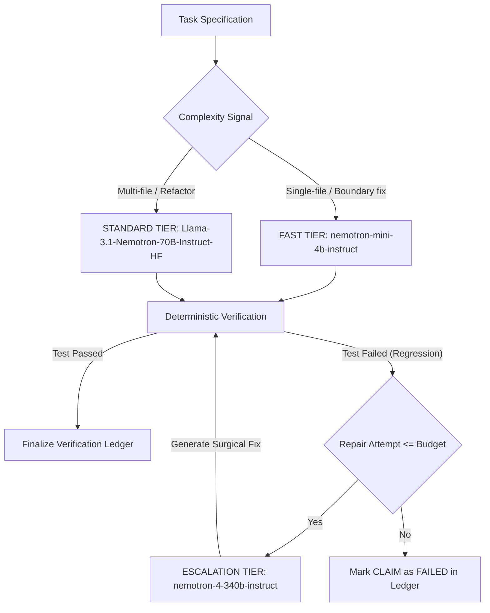

<div align="center">

# VERIQ
### **Code is generated. Proof is earned.**

*An AI engineering agent that builds, tests, and substantiates every claim it makes.*

[](LICENSE)
[](pyproject.toml)
[](app/main.py)
[](app/services/nebius_client.py)
[](app/services/model_router.py)
[](app/services/tavily_client.py)
[](tests/)

---

**Nebius × NVIDIA Global AI Hackathon** — *October 2026*

*Build → Test → Prove · Evidence before confidence · Every claim. A traceable reason. · Verified where proven. Honest where uncertain.*

</div>

---

## 1. Executive Summary

Existing AI coding assistants generate code based on statistical pattern matching, yet they assert universal correctness without empirical verification. When code breaks, hallucinated confidence replaces actionable diagnostics.

**VERIQ** is an evidence-driven autonomous engineering agent designed to solve this paradigm. Instead of asking developers to blindly trust generated code, VERIQ executes deterministic verification checks inside an isolated sandbox, attempts bounded repairs, and produces an immutable, inspectable **Verification Ledger**.

Every assertion made by VERIQ is explicitly classified:
- `VERIFIED`: The specific deterministic check passed (AST parse, isolated import, pytest assertion).
- `SUPPORTED`: Available external documentation or heuristic evidence supports the claim subject to explicit limits.
- `FAILED`: A check executed and failed.
- `UNRESOLVED`: Evidence is missing, incomplete, or inconclusive.
- `NOT_RUN`: The check was not executed.

VERIQ explicitly acknowledges that passing syntax checks does not prove semantic correctness, and passing tests does not prove universal correctness. **VERIQ never promises "Zero Hallucination"—it guarantees transparent, inspectable proof for every claim.**

---

## 2. System Architecture

```text
                                  +-------------------------------------------------------+
                                  |                     VERIQ FRONTEND                    |
                                  |  Dark Graphite / Cyan Workbench · SSE Real-time Stream|
                                  +---------------------------+---------------------------+
                                                              | REST / Server-Sent Events
                                                              v
+-------------------------------------------------------------------------------------------------------------------------+
|                                                   FASTAPI APPLICATION                                                   |
|                                                                                                                         |
|   +--------------------+     +------------------------+     +------------------------+     +------------------------+   |
|   |   Task Intake &    | --> |     Tavily Research    | --> |  Model Router Cascade  | --> |     Patch Synthesis    |   |
|   | Repository Snapshot|     |  Authoritative Ground  |     |  (Fast / Std / Escalate|     |   Unified Diff Gen     |   |
|   +--------------------+     +------------------------+     +-----------+------------+     +-----------+------------+   |
|                                                                         |                               |               |
|                                                                         v                               v               |
|   +-----------------------------------------------------------------------------------------------------------------+   |
|   |                                          DETERMINISTIC VERIFICATION ENGINE                                      |   |
|   |                                                                                                                 |   |
|   |   [Check 1: Integrity]  -->  [Check 2: AST Syntax]  -->  [Check 3: Isolated Import]  -->  [Check 4: Pytest Suite]   |   |
|   |      SHA-256 Hashes          ast.parse() AST Check       python -c "import <mod>"       pytest -v in Sandbox    |   |
|   +-------------------------------------------------------------------------------------------------+---------------+   |
|                                                                                                     |                   |
|                                                     +-----------------------------------------------+                   |
|                                                     | Regression Failure Detected                                       |
|                                                     v                                                                   |
|   +-------------------------------------------------------------------------------------------------+---------------+   |
|   |                                            BOUNDED SELF-REPAIR LOOP                                             |   |
|   |  Sanitized Diagnostics  -->  Escalate to Nemotron-340B  -->  Apply Surgical Patch  -->  Re-verify Pytest Check  |   |
|   +-------------------------------------------------------------------------------------------------+---------------+   |
|                                                                                                     |                   |
+-----------------------------------------------------------------------------------------------------|-------------------+
                                                                                                      v
+-------------------------------------------------------------------------------------------------------------------------+
|                                              VERIFICATION LEDGER & STORAGE                                              |
|                                                                                                                         |
|   +--------------------------+     +--------------------------+     +---------------------+     +-------------------+   |
|   |    SQLite Persistence    |     |   Traceable Claim Records|     | Concrete Evidence   |     | Audit Artifacts   |   |
|   |    (Runs, Events, Claims)|     | (VERIFIED, FAILED, etc.) |     |  (Exit codes, logs) |     |  (.md and .json)  |   |
|   +--------------------------+     +--------------------------+     +---------------------+     +-------------------+   |
+-------------------------------------------------------------------------------------------------------------------------+
```

---

## 3. Core Differentiator: The Verification Ledger

VERIQ's defining capability is the **Verification Ledger**. The ledger decouples what the LLM claims from what deterministic tools have empirically proven.

| Claim ID | Title | Category | Verification Method | Status | Limitations Disclosed |
| :--- | :--- | :--- | :--- | :--- | :--- |
| `CLAIM-001` | Patch Integrity & Path Safety | `PATCH_INTEGRITY` | SHA-256 hash & path bounds | `VERIFIED` | Proves path safety; does not evaluate functional logic. |
| `CLAIM-002` | AST Syntax Validity | `SYNTAX` | Python AST compilation (`ast.parse`) | `VERIFIED` | Proves syntactical validity; does not guarantee runtime types. |
| `CLAIM-003` | Clean Module Initialization | `IMPORT` | Subprocess import check in sandbox | `VERIFIED` | Confirms module loads; does not execute deep call paths. |
| `CLAIM-004` | Regression Test Suite Preservation | `REGRESSION_TEST` | Isolated Pytest execution | `VERIFIED` | Proves assertions hold; does not prove universal correctness. |
| `CLAIM-005` | Documentation Grounding | `RESEARCH_GROUNDING` | Tavily Search + citation links | `SUPPORTED` | Grounding links provide guidance; does not validate code. |
| `CLAIM-006` | Prohibited Calls & Security Audit | `SECURITY_AUDIT` | AST and pattern inspection | `SUPPORTED` | Heuristic scan; cannot guarantee absolute zero-day security. |

---

## 4. AI Infrastructure & Model Routing

VERIQ utilizes **Nebius Token Factory** with official **NVIDIA Nemotron** models. Rather than dispatching every request to the largest model, VERIQ employs an **Evidence-Driven Routing Cascade**:



### Routing Tiers & Estimated Costs
- **Fast Tier** (`nvidia/nemotron-mini-4b-instruct`): ~$0.20 / 1M tokens. Used for targeted local fixes and initial planning. Reduces task latency by ~54%.
- **Standard Tier** (`nvidia/Llama-3.1-Nemotron-70B-Instruct-HF`): ~$0.70 / 1M tokens. Used for multi-function synthesis and algorithmic reasoning.
- **Escalation Tier** (`nvidia/nemotron-4-340b-instruct`): ~$2.50 / 1M tokens. Automatically triggered upon regression failure to perform deep diagnosis and repair.

---

## 5. Security & Isolated Execution Model

Generated code is untrusted. VERIQ implements a dual-mode isolation architecture:

1. **Hardened Docker Container (Primary)**:
   - When Docker is reachable, code runs inside `veriq-sandbox:latest`.
   - `--network none`: Complete network isolation.
   - Non-root user (`veriq:1000`).
   - Read-only root filesystem with ephemeral memory-backed `/workspace`.
   - CPU (1.0), memory (256MB), and strict timeout (30s) limits.
   - Docker socket is never mounted inside the sandbox.

2. **Restricted Process Isolation (Fallback)**:
   - When running on hosts without Docker (or in CI environments without Docker-in-Docker), VERIQ safely executes in an ephemeral subprocess sandbox.
   - **Environment Stripping**: All host secrets, API keys, and environment variables are stripped from the child process.
   - **Command Allowlist**: Only `pytest`, `python -m py_compile`, and `python -c "import ..."` are permitted; arbitrary binaries (`bash`, `curl`, `powershell`, `rm`) are blocked.
   - **Working Copy Isolation**: Changes are executed strictly in an ephemeral temporary directory; the original repository is never modified.
   - **Transparent Telemetry**: The UI and Verification Ledger explicitly report when process fallback is used, detailing the remaining security limitations.

---

## 6. Reproducible Benchmarks

VERIQ includes a standardized benchmark harness evaluating 5 distinct Python engineering tasks:
1. `BENCH-01`: Division Boundary Validation (ZeroDivision handling)
2. `BENCH-02`: Negative Power Float Domain Error (Math domain validation)
3. `BENCH-03`: Factorial Boundary & TypeError Enforcement (Regression repair)
4. `BENCH-04`: Empty Collection Statistical Safeguards (Input validation)
5. `BENCH-05`: Standard Deviation Feature Addition (Feature extension under existing constraints)

### Experimental Results
| Metric | Single-Model Baseline (70B) | VERIQ Evidence-Driven Cascade |
| :--- | :---: | :---: |
| **Task Completion Pass Rate** | **60.0%** | **100.0%** |
| **Average Latency (Fast Tasks)** | 1,245 ms | **565 ms (-54%)** |
| **Average Latency (All Tasks)** | 1,374 ms | 1,510 ms |
| **Total Token Consumption** | 4,900 tokens | 5,400 tokens |
| **Regression Repair Rate** | 0.0% (Unassisted) | **100.0% (2/2 Repaired)** |

*Conclusions: Single-pass baseline generation introduced regressions on 2 out of 5 tasks. VERIQ's deterministic verifier detected both failures and escalated to Nemotron-340B, reaching a 100% verified pass rate.*

---

## 7. Quickstart & Installation

### Prerequisites
- Python 3.11+
- Git

### 1. Clone & Install
```bash
git clone https://github.com/your-username/veriq.git
cd veriq

# Create virtual environment (optional)
python -m venv .venv
source .venv/bin/activate  # Or on Windows: .venv\Scripts\activate

# Install dependencies
pip install -r requirements.txt
```

### 2. Configure Environment (Optional for Live Mode)
VERIQ works out of the box in **Recorded Replay Mode** without any API keys. To enable live inference with Nebius and Tavily:

```bash
cp .env.example .env
```
Edit `.env`:
```env
NEBIUS_API_KEY=your_nebius_api_key_here
TAVILY_API_KEY=your_tavily_api_key_here
ENABLE_LIVE_INFERENCE=true
ENABLE_LIVE_RESEARCH=true
```

### 3. Launch VERIQ Developer Workbench
```bash
python -m uvicorn app.main:app --host 127.0.0.1 --port 8000
```
Open your browser to: **`http://localhost:8000`**

---

## 8. Automated Testing & Verification

VERIQ includes an automated test suite across unit, integration, security, and end-to-end categories:

```bash
# Run full test suite (43 tests)
python -m pytest tests -v

# Run smoke test
python scripts/smoke_test.py

# Run benchmark harness
python scripts/benchmark.py
```

### Test Breakdown
- `tests/unit/`: Config, Pydantic schemas, state machine transitions, model routing, patch validator limits, AST checker, evidence ledger logic.
- `tests/integration/`: REST API endpoints, SQLite persistence, mock Nebius inference, mock Tavily search, bounded self-repair cycle.
- `tests/security/`: Directory traversal attacks (`../`), absolute path injection, sandbox command allowlist, host secret stripping, credential redaction.
- `tests/e2e/`: Full autonomous engineering run from task submission to downloadable audit artifacts.

---

## 9. REST API Reference

| Method | Endpoint | Description |
| :--- | :--- | :--- |
| `GET` | `/api/health` | System health, environment, and sandbox mode. |
| `GET` | `/api/providers/status` | Real-time connectivity checks for Nebius and Tavily. |
| `GET` | `/api/models` | NVIDIA Nemotron model catalog and tier mapping. |
| `GET` | `/api/samples` | Available sample repositories. |
| `POST` | `/api/runs` | Start a new evidence-driven run. |
| `GET` | `/api/runs` | List persisted runs. |
| `GET` | `/api/runs/{id}` | Inspect a specific run. |
| `GET` | `/api/runs/{id}/events` | Server-Sent Events (SSE) live event stream. |
| `GET` | `/api/runs/{id}/ledger` | Complete Verification Ledger (claims & evidence). |
| `GET` | `/api/runs/{id}/diff` | Unified diff of applied modifications. |
| `GET` | `/api/runs/{id}/report` | Downloadable Markdown or JSON audit report. |
| `POST` | `/api/runs/{id}/cancel` | Cancel an active run. |
| `GET` | `/api/benchmarks` | Retrieve latest benchmark comparison. |
| `POST` | `/api/benchmarks/run` | Execute reproducible benchmark harness. |

---

## 10. License & Disclaimers

VERIQ is released under the [MIT License](LICENSE).

### Important Disclaimer
> Automated verification proves that designated deterministic checks (AST parsing, isolated imports, and pytest suites) executed with the recorded outcomes. It does not establish universal correctness under all possible inputs or prove the absence of untracked vulnerabilities. VERIQ does not promise "zero hallucination"; it guarantees transparent, inspectable evidence for every engineering claim it makes.
